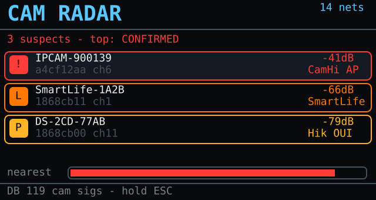
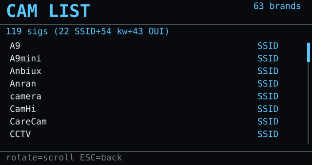
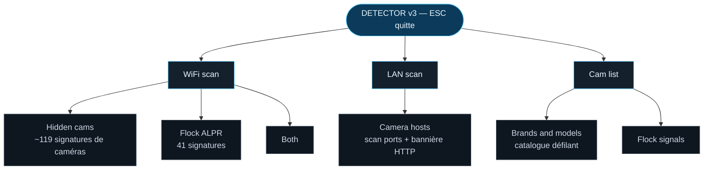
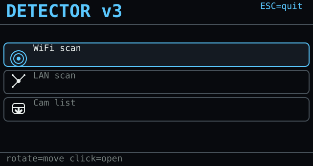
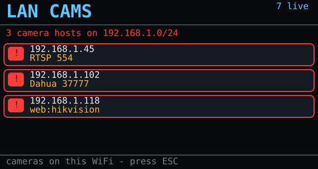
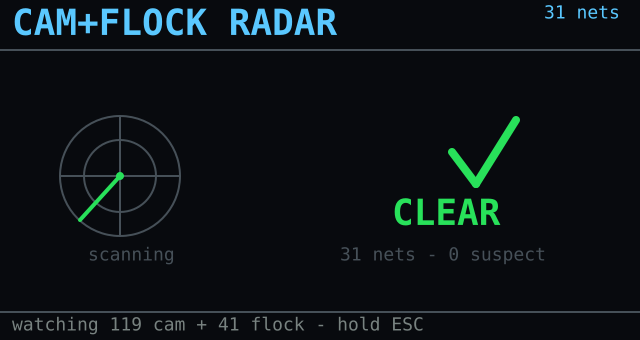

# 🛰️ Flock Detector — détecteur de caméras de surveillance pour Bruce

🇺🇸 <a href="README.md">English</a> · 🇫🇷 <b>Français</b>

  

Une app JavaScript de **contre-surveillance** pour le firmware **[Bruce](https://github.com/pr3y/Bruce)** (testée sur **LilyGO T-Embed CC1101**). Elle scanne le Wi-Fi 2,4 GHz et signale :

- les caméras **LAPI** (lecture automatique de plaques) **Flock Safety** et similaires, et
- les **caméras Wi-Fi « espion » chinoises** bon marché (AliExpress/Amazon),

grâce à leur **OUI MAC** ou au **SSID de leur point d'accès de configuration**, classées selon un modèle de confiance à 4 niveaux et selon la force du signal, pour que tu puisses marcher vers la plus proche (bip façon compteur Geiger). Un mode **scan LAN** séparé trouve les caméras déjà connectées au Wi-Fi sur lequel tu es. **Recherche défensive / vie privée uniquement.**

  
  &nbsp;
  

> ## ⚠️ Usage autorisé uniquement
> À utiliser **uniquement** pour vérifier la présence d'appareils de surveillance autour de **toi**, ou sur des réseaux/lieux que tu es **autorisé** à inspecter. C'est un **récepteur passif** — il ne se connecte jamais à rien, ne lit aucun flux, ne fait aucune désauthentification ni exploitation. Respecte la loi locale.

## 🧭 Plan des menus

  
  
  

## 🎯 Modèle de confiance

Chaque détection est classée, car **l'OUI seul est un indice faible** (beaucoup de modules caméra/LAPI partagent des plages MAC génériques Espressif/HiSilicon utilisées par d'innombrables appareils). **Le SSID est le signal fiable.**

| Niveau | Règle | Couleur |
|---|---|---|
| 🔴 **CONFIRMED** | SSID qui s'identifie lui-même : `Flock-XXXXXX`, `test_flck` (**CVE-2025-59409**), ou un nom de point d'accès de configuration de caméra (ex. `MV########`, `GW_IPC…`, `IPCAM-…`) | rouge |
| 🟠 **LIKELY** | le SSID contient une marque / un mot-clé (`flock`, `v380`, `ipcam`, …) | orange |
| 🟡 **POSSIBLE** | OUI MAC présent dans une liste corroborée / de marques de caméras | ambre |
| ⚪ **WEAK** | OUI MAC présent dans une liste « de départ » non vérifiée | gris |

En plus : **🔊 bip Geiger** (plus rapide/aigu à mesure que tu t'approches), **💾 journal CSV sur la SD** (`/flock_log.csv`), **persistance entre les scans** (une cible perdue sur un scan capricieux reste affichée, grisée, pendant 20 s), et un **compteur de réseaux scannés** en direct. Activation via `BEEP` / `LOG` en tête du script.

## 🚀 Installation

1. Copie **`Flock Detector.js`** sur la carte SD, dans un dossier lu par Bruce : **`/BruceJS`**, `/scripts` ou `/BruceScripts`.
2. Sur l'appareil : **JS Interpreter** → ouvre `Flock Detector.js`.
3. Choisis une catégorie → un mode. **ESC** quitte depuis le menu principal, ou remonte d'un niveau depuis un sous-menu.

## 📷 Signatures de caméras cachées

La plupart des caméras bon marché sans marque **ne diffusent pas leur nom de marque** — elles réutilisent une **app P2P** commune, et le SSID vient de cette app/de ce chipset. Trouve l'app (imprimée sur la boîte / dans l'App Store) et cherche son préfixe ci-dessous.

<!-- BRANDS_TABLE_START -->
### Confirmed setup-AP SSID prefixes

| Brand / app | Setup SSID looks like |
|---|---|
| **A9** | `CAMS_…` |
| **A9mini** | `A9MINI…` |
| **CamHi** | `IPCAM-…` |
| **DGK** | `DGK-…` |
| **ESCAM** | `ESCAM-…` |
| **EZVIZ** | `EZVIZ-…` |
| **FtyCam** | `FTY…` |
| **GENBOLT** | `GENBOLT…` |
| **HDWiFiCam** | `HDWIFICAM…` |
| **IPcam** | `CAM_X…`, `IPC-…` |
| **JXLCAM** | `JXLCAM…` |
| **JXLCAM/A9** | `ACCQ…` |
| **Linklemo** | `LLM_…` |
| **Naxclow** | `NAX_…` |
| **O-KAM** | `@MC…` |
| **Ring** | `RINGSETUP…` |
| **UBox** | `UBOX_…` |
| **V380** | `MV########…` |
| **V720** | `V720…` |
| **Yoosee** | `GW_IPC…` |
| **Zosi** | `IPC_AP…` |

### Camera-brand MAC OUIs (POSSIBLE tier)

| Vendor | OUI prefixes |
|---|---|
| **Dahua** | 9 |
| **Foscam** | 2 |
| **Hikvision** | 23 |
| **Reolink** | 2 |
| **Ring** | 2 |
| **Wyze** | 5 |

> Router-first brands (**TP-Link / Tapo**) are **excluded on purpose** — on an AP scan their OUI is a false-positive magnet.

### Brand / keyword matches (LIKELY tier)

`anbiux` · `anran` · `camera` · `camhi` · `carecam` · `cctv` · `cloudedge` · `coolcam` · `escam` · `ezviz` · `foscam` · `fredi` · `ftycam` · `genbolt` · `hdminicam` · `hdsmartipc` · `hopeway` · `icsee` · `iegeek` · `imcam` · `ipcam` · `iwfcam` · `linklemo` · `littlestars` · `lookcam` · `minicam` · `naxclow` · `netcam` · `okam` · `ptz` · `reolink` · `smartcam` · `smartlife` · `spycam` · `sricam` · `tinycam` · `tutk` · `tuya` · `ubox` · `ucocare` · `ular` · `v380` · `vstarcam` · `webcam` · `wificam` · `wiwacam` · `xiaoin` · `chuangmi` · `xmeye` · `ycc365` · `yoosee` · `zosi`
<!-- BRANDS_TABLE_END -->

*(Tableau ci-dessus généré automatiquement depuis `sigs.json`, laissé en anglais. Les marques routeur comme **TP-Link / Tapo** sont **exclues volontairement** : sur un scan de points d'accès, leur OUI attire les faux positifs.)*

La liste complète, avec les nombres et les marqueurs de détection, est consultable sur l'appareil dans **Cam list → Brands & models**.

## 🌐 Caméras LAN — celles déjà connectées au Wi-Fi

Le scan radio ne voit une caméra que si elle **diffuse un point d'accès** (mode appairage/configuration). Une caméra **déjà appairée** est un **client** Wi-Fi silencieux, sans SSID → invisible à un scan de points d'accès. **LAN cams** couvre cet angle mort : pendant que le LilyGO est connecté à un Wi-Fi, il balaie le sous-réseau et signale les **hôtes caméras** grâce à leurs **ports ouverts** (`554`/`8554` RTSP, `37777` Dahua, `34567` XiongMai, `8000` Hikvision, `8899` ONVIF) et à leur **bannière HTTP** (Hikvision/Dahua/Reolink/Foscam/ONVIF…).

> ⚠️ **Limites du firmware.** Le JS de Bruce n'expose que `httpFetch` (pas de socket brut, pas d'UDP, pas d'ARP) → la détection se fait **uniquement par ports + bannière, sans OUI/MAC**, et il n'y a **pas de découverte ONVIF WS-Discovery**. Le délai de connexion **ne peut pas être raccourci**, donc une IP morte est lente. La solution n'est pas de « sauter les IP mortes » (on ne sait qu'une IP est morte *qu'après* le délai) — c'est d'en **sonder beaucoup moins** : une **fenêtre autour de notre propre IP** (`LAN_SPAN`, ±25) + la passerelle (le DHCP regroupe les adresses par là), et **un seul test par IP**. Pendant un test bloquant, le moteur JS est figé : **maintiens ESC** — il s'arrête dès que le test en cours se termine.

## 📋 Liste des caméras & mise à jour de la base

**Cam list → Brands & models** affiche le nombre total de signatures et le catalogue trié des marques/modèles, chacun marqué **SSID** / **OUI** / **SSID+OUI**.

Les signatures se trouvent aussi dans **[`sigs.json`](sigs.json)**. Pour **ajouter des caméras sans retoucher le script**, dépose un fichier **`flock_sigs.json`** à la **racine de la carte SD** (avec seulement les *nouvelles* entrées) — il est **chargé et fusionné au démarrage** (`loadCachedSigs`), sans doublons. Le nouveau total apparaît dans **Cam list**.

> ℹ️ **Pourquoi la SD et pas internet ?** GitHub n'est accessible qu'en HTTPS et la **pile TLS de l'ESP32 échoue souvent sous Bruce** (`Connection refused`). La mise à jour par SD ne demande **aucun réseau** et marche à tous les coups.

Format de `sigs.json` : `cam_ssid_conf` `[["regex","libellé"]]`, `cam_ssid_like` `[["sous-chaîne","libellé"]]`, `cam_oui` `[["oui","fabricant"]]`, `flock_oui` `["oui"]`, `flock_seed` `["oui"]`.

## 🔎 Sources

- **OUI Flock** — recherche en mode promiscuous de [@NitekryDPaul](https://github.com/nitekry/nite-oui-collection) (`my_tested_flock`, synchronisé le 16/07/2026) + [DeFlockJoplin](https://github.com/DeflockJoplin/flock-you) ; liste de départ issue de [FlipDeFlock](https://github.com/ReconGrunt/FlipDeFlock) / WatchFlock. Règles SSID : `Flock-XXXXXX`, `test_flck` (CVE-2025-59409).
- **OUI de caméras** — [colonelpanichacks/ouispy-detector](https://github.com/colonelpanichacks/ouispy-detector), [room-sweep](https://github.com/grahamandre23-lang/room-sweep), [camera-detector](https://github.com/ranjansinghx/camera-detector).
- **Préfixes SSID de caméras** — guides de configuration publics (qztsecurity, manuals.plus, docs des fabricants) et les recherches naxclow / a9-v720.
- *(Les signatures BLE nécessitent des empreintes IE en mode promiscuous que `ble.scan` de Bruce n'expose pas — laissées pour un futur module du firmware.)*

## 🧩 Angle mort & méthodes complémentaires

Cet outil ne voit que le **Wi-Fi radio**. Une caméra **déjà appairée** (client silencieux) ou **hors ligne** (enregistre sur SD, n'émet rien) lui est invisible. D'autres méthodes couvrent ces cas — complémentaires, pas concurrentes :

| Méthode | Principe | Couvre notre angle mort ? | Réf. |
|---|---|---|---|
| **Scan radio / points d'accès Wi-Fi** (cet outil) | scan des points d'accès + OUI/SSID | — | ce dépôt |
| **Scan LAN** (mode LAN de cet outil **et** outils PC) | même réseau : ports (554 RTSP…) + bannière ; PC : nmap + mDNS/ONVIF + OUI | ✅ caméra **appairée à ce Wi-Fi** | ce dépôt, [room-sweep](https://github.com/grahamandre23-lang/room-sweep), [camera-detector](https://github.com/ranjansinghx/camera-detector) |
| **Optique (ToF/LiDAR)** | rétroréflexion de l'objectif via le capteur ToF d'un téléphone | ✅ **toute** caméra, même hors ligne | [LAPD](https://github.com/frizensami/lapd) (ACM SenSys 2021) |
| **Thermique (ML)** | signature thermique de la caméra via caméra thermique + réseau de neurones | ✅ **toute** caméra, même hors ligne | [HeatDeCam](https://heatdecam.github.io/) |
| **Vision (ML)** | webcam + détection d'objets (TensorFlow COCO-SSD) | ⚠️ visuel, peu fiable | [Spy_Cam_Detection](https://github.com/tanishqshah2/Spy_Cam_Detection) |
| **Détecteur d'objectif IR** | LED IR + œil : l'objectif renvoie un point brillant | ✅ caméras hors ligne, pas cher | matériel dédié |

## 🛒 Matériel

*Liens partenaires Amazon : si vous achetez via ces liens, le projet touche une petite commission, sans surcoût pour vous.*

<table>
<tr>
<td align="center" width="33%">
   
  <b><a href="https://www.amazon.fr/dp/B0D45MSMJR?linkCode=ll2&amp;tag=koua29bflockdetector-21&amp;ref_=as_li_ss_tl">Batterie Anker 545 (10 000 mAh)</a></b> Pour faire tourner le T-Embed loin d'une prise
</td>
<td align="center" width="33%">
   
  <b><a href="https://www.amazon.fr/dp/B0C1FCZM94?linkCode=ll2&amp;tag=koua29bflockdetector-21&amp;ref_=as_li_ss_tl">Antenne SMA 433 MHz (lot de 2)</a></b> Antenne sub-GHz pour la radio CC1101
</td>
<td align="center" width="33%">
   
  <b><a href="https://www.amazon.fr/dp/B0B7NVMBPL?linkCode=ll2&amp;tag=koua29bflockdetector-21&amp;ref_=as_li_ss_tl">microSD SanDisk 64 Go (lot de 2)</a></b> Pour les thèmes, scripts et captures Bruce
</td>
</tr>
</table>

En tant que Partenaire Amazon, je réalise un bénéfice sur les achats remplissant les conditions requises.

## ☕ Un café ?

## 📄 Licence

MIT — voir [LICENSE](LICENSE). Par **koua29**. Tourne sur l'excellent [Bruce firmware](https://github.com/pr3y/Bruce). Usage défensif / autorisé uniquement.
